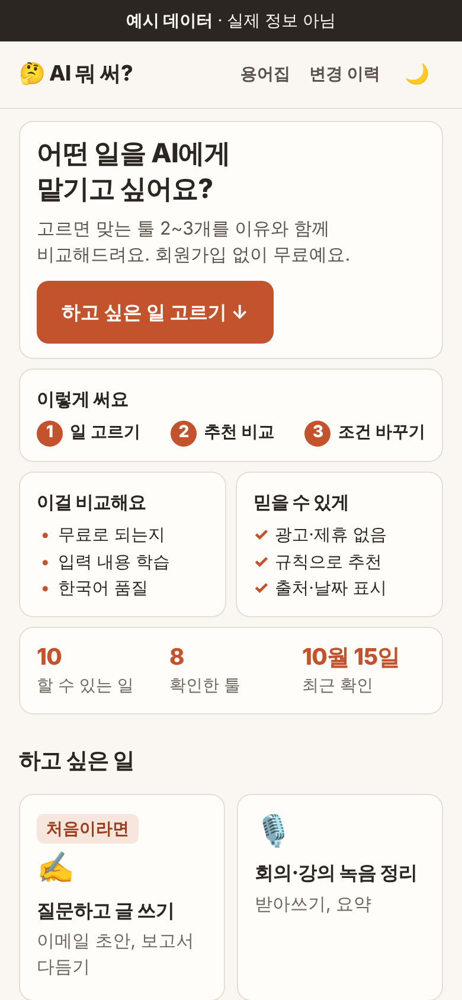
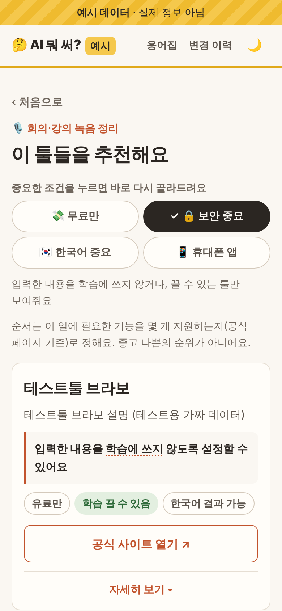
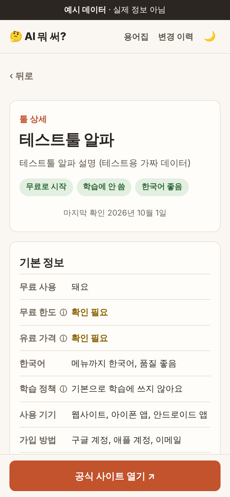
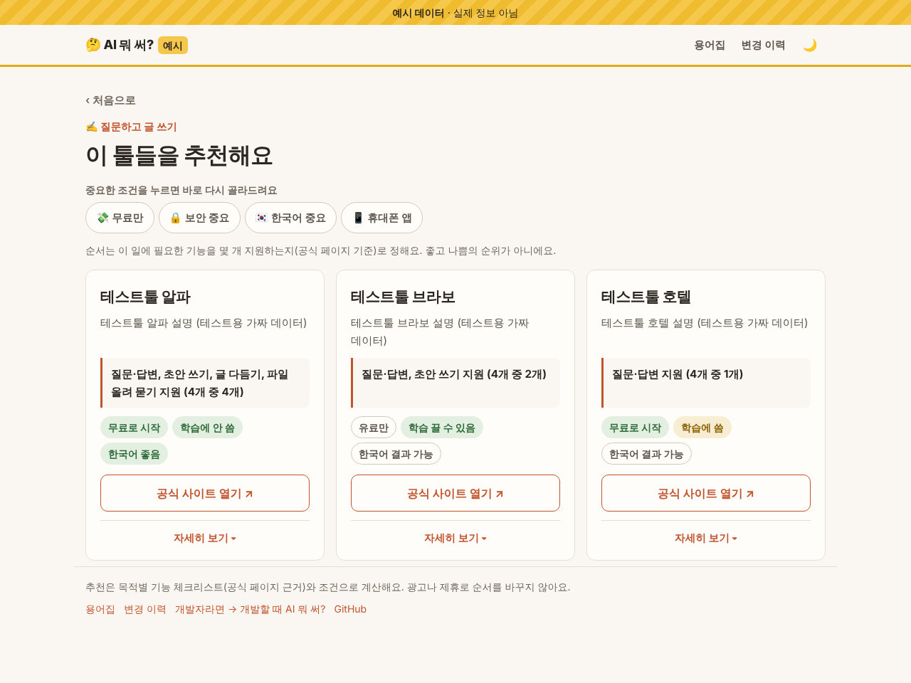
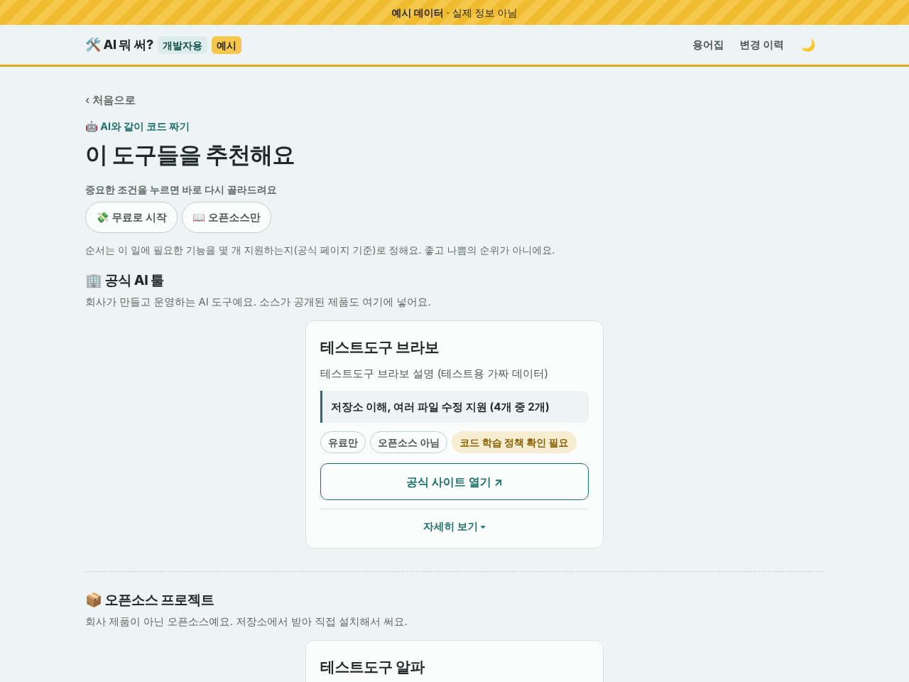

# AI 뭐 써?

> "회의록 정리하고 싶은데 뭐 써?"에 답하는 사이트.
> 하고 싶은 일을 고르면 맞는 AI 툴 2~3개를 **이유와 함께** 비교해주는 비개발자용 선택 도우미예요.

**👉 사이트: [dlwldp.github.io/which-ai](https://dlwldp.github.io/which-ai/)** · [예시 데이터로 둘러보기](https://dlwldp.github.io/which-ai/?demo#/)  
**🛠️ 개발자용: [개발할 때 AI 뭐 써?](https://dlwldp.github.io/which-ai/dev/)** · [예시 데이터로 둘러보기](https://dlwldp.github.io/which-ai/dev/?demo#/)

| 휴대폰: 홈 | 휴대폰: 추천 결과 | 휴대폰: 툴 상세 |
| --- | --- | --- |
|  |  |  |



<sub>※ 스크린샷은 화면 확인용 예시 데이터(지어낸 툴)로 찍었어요.</sub>

## 왜 만들었나

AI 툴이 너무 많아서 비개발자는 어떤 일에 뭘 써야 하는지, 무료로 되는지, 회사 자료를 넣어도 되는지 판단하기 어려워요. 기존 AI 디렉터리는 수천 개를 나열만 해서 오히려 고르기 힘들어요.
그래서 **목록을 보여주지 않고**, 목적과 조건을 고르면 2~3개만 골라서 비교해줘요. 그 밖의 후보도 빠지지 않게 접힌 "다른 후보 더 보기"에 같은 순서로 남겨 둬요.

## 이렇게 써요

1. **하고 싶은 일 고르기:** 질문하고 글 쓰기, 회의 녹음 정리, PPT 만들기… 10가지 (처음이라면 "처음이라면" 표시가 붙은 일부터)
2. **바로 추천 비교:** 카드마다 대표 추천 이유 한 줄(켠 조건과 관련된 이유가 먼저)과 한눈에 보는 배지(무료 · 학습 정책 · 한국어). "자세히 보기"를 열면 이 일에 필요한 기능 체크리스트(✓ 지원 / – 확인 안 됨), 무료 한도, 유료 가격, 사용 기기, 시작 방법 3단계, 주의할 점, 마지막 확인 날짜와 출처
3. **조건 바꾸기:** 결과 위 칩(무료만 / 보안 중요 / 한국어 중요 / 휴대폰 앱)을 누르면 바로 다시 골라줘요

## 설계 원칙

| 원칙 | 이렇게 지켜요 |
| --- | --- |
| **추천은 규칙으로** | 사이트에서 AI(LLM)를 부르지 않아요. 목적마다 정해 둔 기능 체크리스트 4개 중 몇 개를 지원하는지(공식 페이지 근거)와 조건으로 계산해서, 같은 입력이면 항상 같은 결과가 나와요. 순서는 좋고 나쁨의 순위가 아니에요 ([js/recommend.js](js/recommend.js)) |
| **이유 없는 추천 금지** | 모든 추천 카드에 "왜 추천했는지" 문장이 붙어요 |
| **모르면 모른다고** | 확인 안 된 값은 "확인 필요"로 보여주고, 보안 조건에서는 학습 정책을 모르는 툴을 추천하지 않아요 |
| **출처와 확인 날짜** | 가격·정책에는 공식 페이지 출처와 확인 날짜가 있어요. 90일이 지나면 "확인 필요" 배지가 붙고, 매주 자동 점검이 Issue로 알려줘요 |
| **AI는 초안만, 확정은 사람이** | 툴 정보는 AI가 공식 페이지를 근거로 초안을 쓰고, 사람이 근거 문장을 대조한 뒤에만 실제 데이터로 옮겨요 ([drafts/README.md](drafts/README.md)) |
| **운영비 0원** | 서버·회원가입·외부 패키지 없이 정적 파일 + GitHub Pages + GitHub Actions |
| **광고·제휴 없음** | 추천 순서를 돈으로 바꾸지 않아요 |

## 정보가 틀렸나요?

카드의 "자세히 보기" 안이나 툴 상세 화면에서 **"정보가 틀려요 ↗"**를 눌러 알려주세요 ([제보 양식](https://github.com/dlwldP/which-ai/issues/new?template=wrong-info.yml), GitHub 계정 필요). 자세한 건 [CONTRIBUTING.md](CONTRIBUTING.md)를 봐주세요.

## 개발자용: 개발할 때 AI 뭐 써?

같은 엔진으로 만든 개발자용 버전이에요. 기획, 앱 만들기, 코딩 에이전트, 백엔드, 디자인, 데이터·RAG, 배포, 자동화, 코드 리뷰 9가지 단계에서 도구를 비교해요. 추천은 **공식 AI 툴**(회사가 만들고 운영하는 제품)과 **오픈소스 프로젝트**(GitHub 저장소) 두 섹션으로 나눠 각각 최대 3개씩 보여줘요. AI 툴이 아닌 도구(데이터베이스, 컨테이너 등)는 "AI와 같이 쓰는 도구"로 따로 표시해요. ([기획서](docs/개발자용_기획서.md))



---

# 개발 문서

- 기획서: [docs/AI뭐써_기획서.md](docs/AI뭐써_기획서.md) · 개발자용: [docs/개발자용_기획서.md](docs/개발자용_기획서.md)
- 세부 결정 사항: [docs/decisions.md](docs/decisions.md)
- 사용성 테스트 가이드: [docs/사용성테스트.md](docs/사용성테스트.md)

## 현재 상태

| Phase | 상태 |
| --- | --- |
| 0. 데이터 | 목적 정의 완료. **실제 툴 데이터는 마지막에 입력 예정** (`data/tools.json`, `data/dev/tools.json` 비어 있음) |
| 1. 추천 로직 | 완료 |
| 2. 화면 | 완료 (예시 데이터로 확인) |
| 3. 상세·부가 | 툴 상세, 용어집, 변경 이력, 다크 모드 완료 |
| 4. 배포·자동화 | Pages 배포, 주간 신선도·링크 점검 Issue 완료 |
| 5. 마감 | README, 제보 양식·기여 안내, 스크린샷, 사용성 테스트 가이드 완료. **사용성 테스트(비개발자 3명)는 진행 전** |
| 개발자용 | D0~D3 완료, D4(실제 도구 데이터)는 마지막에 |

## 폴더

```
index.html   화면 (한 페이지, 주소 #/... 로 화면 구분)
dev/         개발자용 화면 (같은 js/app.js를 개발자용 모드로 씀)
css/         styles.css
data/        목적·툴·용어집·변경 이력 (JSON). demo-*.json은 화면 확인·테스트용 가짜 데이터
js/          recommend.js — 추천 로직 (순수 함수, DOM 접근 없음)
             format.js    — 데이터 값을 화면 문구로 바꾸는 순수 함수
             glossary.js  — 문장 속 용어에 밑줄을 씌우는 순수 함수
             changelog.js — tools.json 두 버전을 비교하는 순수 함수
             modes.js     — 비개발자용·개발자용 화면 문구, 조건, 비교 항목
             app.js       — 화면 그리기와 주소 처리
drafts/      확인 전 툴 정보 초안 (배포 안 됨, drafts/README.md 참고)
scripts/     validate-data.js — 데이터 검사
             draft.js — 초안 검사, 확인한 툴을 실제 데이터로 옮기기 (--dev는 개발자용)
             build-changelog.js — git 기록으로 변경 이력 만들기 (배포할 때 자동 실행)
             check-freshness.js — 주간 점검: 90일 지난 툴, 링크 상태 → Issue 본문
             validate-dev-data.js — 개발자용 데이터 검사 (docs/개발자용_기획서.md)
tests/       Node 내장 테스트 러너
docs/        기획서, 결정 사항, 사용성 테스트 가이드, 스크린샷
.github/     배포·주간 점검 워크플로, "정보가 틀려요" 제보 양식
```

## 실행

Node 22 이상, 설치할 패키지 없음.

```sh
node --test                          # 테스트
node scripts/validate-data.js        # 데이터 검사 (기준일: 오늘)
node scripts/validate-data.js 2026-10-19   # 기준일 지정
node scripts/validate-dev-data.js    # 개발자용 데이터 검사
node scripts/draft.js check          # 초안 검사 (비개발자용·개발자용)
node scripts/build-changelog.js      # 변경 이력을 data/changelog.json에 만들기 (로컬에서 화면 볼 때만, 커밋하지 않음)
node scripts/check-freshness.js      # 주간 점검을 직접 돌려보기 (결과: report.md, --demo는 예시 데이터)
```

## 배포

`main`에 푸시하면 `.github/workflows/deploy.yml`이 테스트·데이터 검사를 돌리고, 통과하면 git 기록으로 변경 이력을 만들어 GitHub Pages에 올린다. 배포 주소는 맨 위 링크를 봐주세요.

## 주간 점검

`.github/workflows/weekly-check.yml`이 매주 월요일 오전 9시쯤(한국 시간) 실행된다.

- 비개발자용(`data/tools.json`)과 개발자용(`data/dev/tools.json`)을 함께 점검한다.
- 90일 넘게 확인 안 된 툴, 깨진 공식 주소·출처·저장소·배울 거리 링크가 있으면 "주간 점검" 라벨 Issue 하나에 목록을 모은다 (이미 열려 있으면 내용만 갱신).
- 모두 처리되면 다음 점검 때 Issue가 자동으로 닫힌다.
- 가격·정책 값은 자동으로 바꾸지 않는다. 확인할 목록만 만든다.
- Actions 탭에서 수동 실행할 수 있고, "demo"를 고르면 예시 데이터로 동작을 확인한다.

## 화면 보기

빌드 없이 정적 파일을 그대로 쓴다. `fetch`를 쓰기 때문에 파일을 더블클릭하지 말고 로컬 서버로 연다.

```sh
python3 -m http.server 8000
# http://localhost:8000/            실제 데이터 (지금은 "아직 준비 중이에요")
# http://localhost:8000/?demo#/     예시 데이터로 화면 확인
# http://localhost:8000/dev/?demo#/ 개발자용 예시
```

## 추천 함수 사용법

```js
import { recommend } from './js/recommend.js';

const { results, relaxed, notice } = recommend({
  tools,                       // data/tools.json
  purposeId: 'P02',
  conditions: { freeOnly: false, securityImportant: true, koreanImportant: false, mobile: true },
  today: '2026-10-19',         // 같은 입력이면 같은 결과가 나오도록 날짜를 직접 넘긴다
  purposeFeatures,             // 그 목적의 기능 체크리스트 (data/purposes.json의 features). 이유 문장에 기능 이름을 쓴다
});
// 점수 = 지원 기능 수 × 10 + 한국어 + 무료 - 90일 지남
// results: 최대 3개 [{ id, tool, score, reasons, features, stale }]  reasons[0] 예: "받아쓰기, 요약 지원 (4개 중 2개)"
// relaxed: 결과가 0개라서 뺀 조건 (휴대폰 → 무료 순, 보안 조건은 빼지 않음)
// notice:  "휴대폰 앱 조건을 빼면 이런 선택지가 있어요" / "조건에 맞는 툴이 아직 없어요" / null
```
