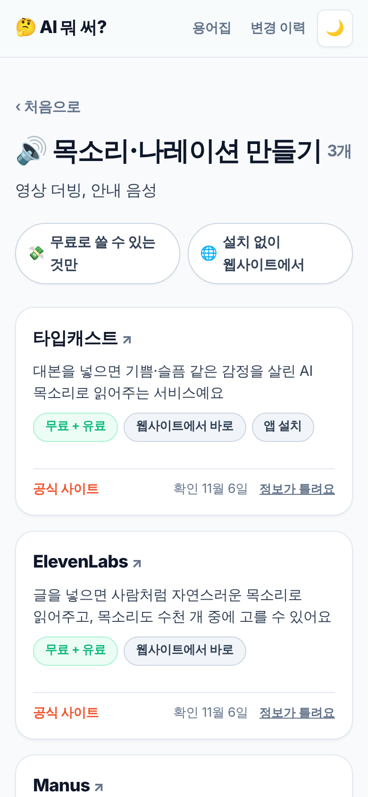
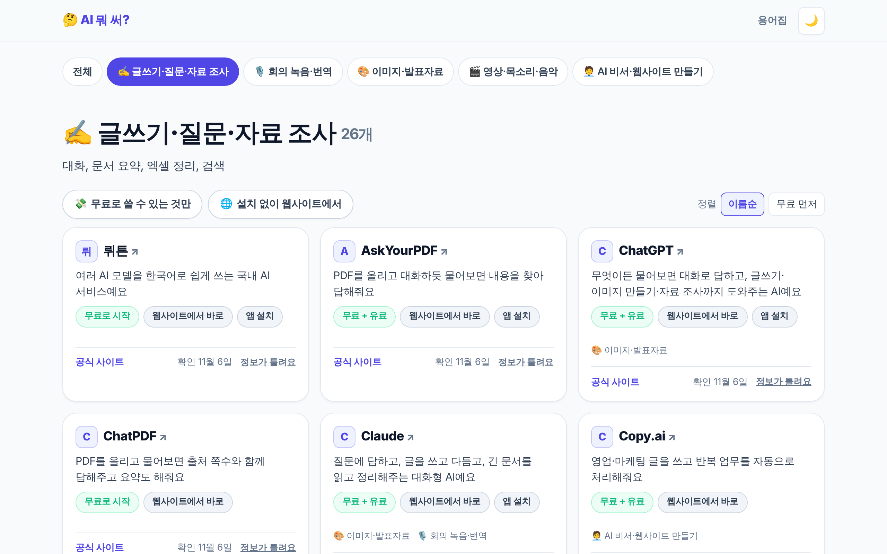
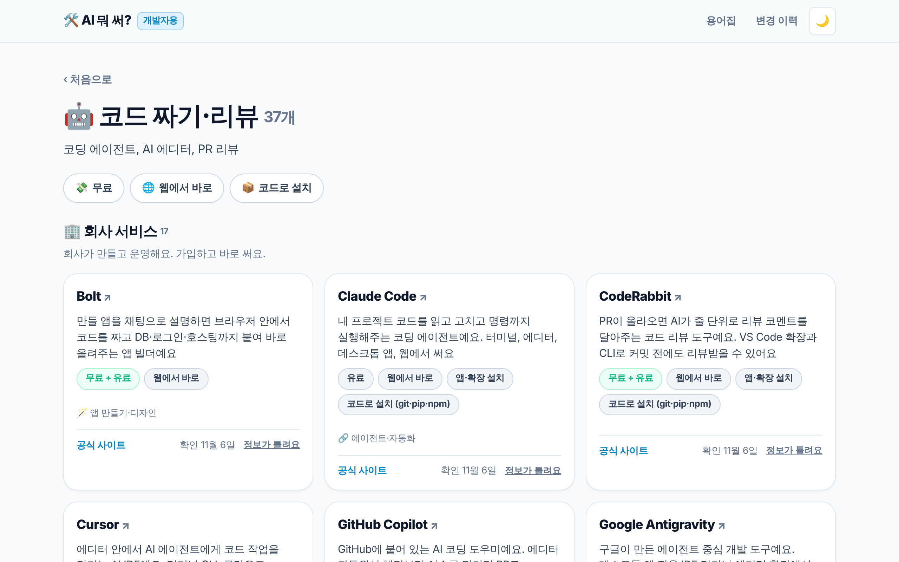

# AI 뭐 써?

> "이미지 만들 땐 뭐가 있지?"에 답하는 사이트.
> 하고 싶은 일별로 쓸 수 있는 AI를 **최대한 많이** 모아, 무료인지와 어떻게 쓰는지만 짧게 보여줘요.

**👉 사이트: [dlwldp.github.io/which-ai](https://dlwldp.github.io/which-ai/)**  
**🛠️ 개발자용: [개발할 때 AI 뭐 써?](https://dlwldp.github.io/which-ai/dev/)**

| 휴대폰: 홈 | 휴대폰: 용도별 목록 |
| --- | --- |
|  |  |



## 왜 만들었나

AI가 너무 많은데 사람들은 GPT·Claude 정도만 알아요. 이미지·영상·목소리·번역·음악 같은 일마다 어떤 AI가 있는지, 무료로 되는지 한 번에 보기 어려워요.
그래서 **용도별로 최대한 많이** 모으고, 카드 한 장에 꼭 필요한 것만 적어요 (2026-11-06 개편).

## 이렇게 써요

1. **하고 싶은 일 누르기:** 글쓰기·질문·자료 조사 / 회의 녹음·번역 / 이미지·발표자료 / 영상·목소리·음악 / AI 비서·웹사이트 만들기, 5가지. 이름이나 하고 싶은 일로 찾을 수도 있어요
2. **카드 보기:** 이름(누르면 공식 사이트), 한 줄 설명, **무료 / 무료 + 유료 / 유료**, **쓰는 방법**(웹사이트에서 바로 / 앱 설치 / 직접 설치)
3. **조건 칩:** 무료로 쓸 수 있는 것만, 설치 없이 웹사이트에서

## 설계 원칙

| 원칙 | 이렇게 지켜요 |
| --- | --- |
| **최대한 많이, 짧게** | 툴 수 상한이 없어요. 카드에는 가격과 쓰는 방법만 |
| **가격은 공식 문장으로** | 무료·유료는 공식 사이트 문장으로 확인해요. 모르면 "가격 확인 필요"로 보여주고 추측하지 않아요 |
| **확인 날짜** | 카드마다 확인 날짜가 있고, 90일이 지나면 "다시 확인 필요"가 붙어요. 매주 자동 점검이 Issue로 알려줘요 |
| **규칙으로 정렬** | 사이트에서 AI(LLM)를 부르지 않아요. 이름순이라 좋고 나쁨의 순위가 아니에요 ([js/recommend.js](js/recommend.js)) |
| **운영비 0원** | 서버·회원가입·외부 패키지 없이 정적 파일 + GitHub Pages + GitHub Actions |
| **광고·제휴 없음** | 순서를 돈으로 바꾸지 않아요 |

## 정보가 틀렸나요?

카드 아래 **"정보가 틀려요"**를 눌러 무엇이 틀렸는지 적어 주세요. 로그인이 필요 없어요. 자세한 건 [CONTRIBUTING.md](CONTRIBUTING.md)를 봐주세요.

## 개발자용: 개발할 때 AI 뭐 써?

같은 화면으로 만든 개발자용 버전이에요. 코드 짜기·리뷰, 앱 만들기·디자인, 모델·데이터·RAG, 에이전트·자동화, 백엔드·배포 5가지 단계마다 **회사 서비스 / 오픈소스 프로젝트(GitHub) / 공개 모델(Hugging Face)**로 묶어서 보여줘요. 카드에는 웹에서 바로 쓰는지, 코드로 설치(git·pip·npm)하는지가 나와요. AI 툴이 아닌 도구는 "AI와 같이 쓰는 도구"로 따로 표시해요. ([기획서](docs/개발자용_기획서.md))



---

# 개발 문서

- 기획서: [docs/AI뭐써_기획서.md](docs/AI뭐써_기획서.md) · 개발자용: [docs/개발자용_기획서.md](docs/개발자용_기획서.md)
- 세부 결정 사항: [docs/decisions.md](docs/decisions.md)
- 사용성 테스트 가이드: [docs/사용성테스트.md](docs/사용성테스트.md)

## 현재 상태

| Phase | 상태 |
| --- | --- |
| 2026-11-06 개편 | 추천 → 용도별 모음. 카드 목록, 이름 찾기, 조건 칩 완료. 툴을 계속 늘리는 중 |
| 부가 | 용어집, 변경 이력, 다크 모드, 정보가 틀려요(구글 폼), 하단 안내 문서 완료 |
| 4. 배포·자동화 | Pages 배포, 주간 신선도·링크 점검 Issue 완료 |
| 5. 마감 | README, 제보 양식·기여 안내, 스크린샷, 사용성 테스트 가이드 완료. **사용성 테스트(비개발자 3명)는 진행 전** |
| 개발자용 | 같은 개편 적용. 오픈소스·공개 모델을 계속 늘리는 중 |

## 폴더

```
index.html   화면 (한 페이지, 주소 #/... 로 화면 구분)
dev/         개발자용 화면 (같은 js/app.js를 개발자용 모드로 씀)
css/         styles.css
data/        목적·툴·용어집·변경 이력 (JSON). demo-*.json은 화면 확인·테스트용 가짜 데이터
js/          recommend.js — 목록 로직: 용도·조건·찾는 말로 거르고 이름순 (순수 함수, DOM 접근 없음)
             format.js    — 데이터 값을 화면 문구로 바꾸는 순수 함수
             glossary.js  — 문장 속 용어에 밑줄을 씌우는 순수 함수
             changelog.js — tools.json 두 버전을 비교하는 순수 함수
             modes.js     — 비개발자용·개발자용 화면 문구, 조건 칩, 묶음
             app.js       — 화면 그리기와 주소 처리
drafts/      확인 전 툴 정보 초안 (배포 안 됨, drafts/README.md 참고)
scripts/     validate-data.js — 데이터 검사
             draft.js — 초안 검사, 대조한 초안을 실제 데이터로 옮기기 (promote-all, --dev는 개발자용)
             review-checklist.js — 남은 초안 목록(drafts/REVIEW.md) 만들기
             build-changelog.js — git 기록으로 변경 이력 만들기 (배포할 때 자동 실행)
             check-freshness.js — 주간 점검: 90일 지난 툴, 링크 상태 → Issue 본문
             validate-dev-data.js — 개발자용 데이터 검사 (docs/개발자용_기획서.md)
tests/       Node 내장 테스트 러너
docs/        기획서, 결정 사항, 사용성 테스트 가이드, 스크린샷
.github/     배포·주간 점검 워크플로, "정보가 틀려요" 제보 양식
```

## 실행

Node 22 이상, 설치할 패키지 없음.

```sh
node --test                          # 테스트
node scripts/validate-data.js        # 데이터 검사 (기준일: 오늘)
node scripts/validate-data.js 2026-10-19   # 기준일 지정
node scripts/validate-dev-data.js    # 개발자용 데이터 검사
node scripts/draft.js check          # 초안 검사 (비개발자용·개발자용)
node scripts/review-checklist.js     # 남은 초안 목록 drafts/REVIEW.md 만들기
node scripts/build-changelog.js      # 변경 이력을 data/changelog.json에 만들기 (로컬에서 화면 볼 때만, 커밋하지 않음)
node scripts/check-freshness.js      # 주간 점검을 직접 돌려보기 (결과: report.md, --demo는 예시 데이터)
```

## 배포

`main`에 푸시하면 `.github/workflows/deploy.yml`이 테스트·데이터 검사를 돌리고, 통과하면 git 기록으로 변경 이력을 만들어 GitHub Pages에 올린다. 배포 주소는 맨 위 링크를 봐주세요.

## 검색 등록 (Google Search Console)

두 사이트의 `<head>`에 소유 확인 태그가 있고, 배포할 때 `sitemap.xml`이 함께 올라가요. Search Console에서 소유를 확인한 뒤 `https://dlwldp.github.io/which-ai/sitemap.xml`을 제출해요. 화면이 `#/…` 주소로 나뉘어서 검색에는 두 사이트의 첫 화면만 잡혀요.

## 주간 점검

`.github/workflows/weekly-check.yml`이 매주 월요일 오전 9시쯤(한국 시간) 실행된다.

- 비개발자용(`data/tools.json`)과 개발자용(`data/dev/tools.json`)을 함께 점검한다.
- 90일 넘게 확인 안 된 툴, 깨진 공식 주소·출처·저장소 링크가 있으면 "주간 점검" 라벨 Issue 하나에 목록을 모은다 (이미 열려 있으면 내용만 갱신).
- 모두 처리되면 다음 점검 때 Issue가 자동으로 닫힌다.
- 가격 값은 자동으로 바꾸지 않는다. 확인할 목록만 만든다.
- Actions 탭에서 수동 실행할 수 있고, "demo"를 고르면 예시 데이터로 동작을 확인한다.

## 화면 보기

빌드 없이 정적 파일을 그대로 쓴다. `fetch`를 쓰기 때문에 파일을 더블클릭하지 말고 로컬 서버로 연다.

```sh
python3 -m http.server 8000
# http://localhost:8000/            실제 데이터
# http://localhost:8000/?demo#/     예시 데이터로 화면 확인 (개발용, 사이트에서는 링크하지 않음)
# http://localhost:8000/dev/?demo#/ 개발자용 예시 (개발용)
```

## 목록 함수 사용법

```js
import { listTools } from './js/recommend.js';

const tools = listTools({
  tools,                  // data/tools.json
  purposeId: 'P05',       // 없으면 전체
  filters: ['free'],      // free(무료로 쓸 수 있음) / web(웹사이트에서 바로) / install(코드로 설치)
  query: '',              // 이름·한 줄 설명에서 찾을 말
});
// 이름순 배열. 같은 입력이면 항상 같은 결과
```
